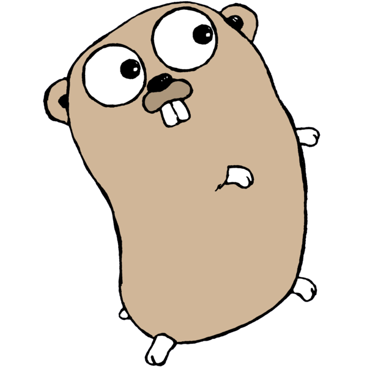

<div align="center">



# gopherlings

### 🐹 Learn Go by fixing tiny, broken programs.

*Inspired by [rustlings](https://github.com/rust-lang/rustlings) and [ziglings](https://codeberg.org/ziglings/exercises).*


</div>

---

## ✨ What is this?

**gopherlings** is a set of 65 small Go exercises — each one a tiny program with
something *deliberately wrong* — plus a single self-contained binary that
watches your edits, runs the tests, and walks you through the curriculum in
order.

No boilerplate. No project setup. No dependencies to download. You fix, you
save, you learn.

```console
$ gopherlings
gopherlings 0.1.0 — 65 exercises, 4 done

── exercises/01_variables/05_iota · Enumerations with iota
✗ 1 of 2 tests failed:
  ✗ TestWeekdayValues
      exercise_test.go:14: Saturday = 7, want 6

Stuck? Run `gopherlings hint` for a nudge.

Watching for changes… (Ctrl+C to quit)
```

…you fix the line…

```console
── exercises/01_variables/05_iota · Enumerations with iota
✓ All 2 tests pass! (0.1s)

✓ Complete: Enumerations with iota

Next up: Struct Literals
  exercises/05_structs/01_structs/exercise.go
  progress: 5/65
```

## 🚀 Quick start

You need **Go 1.24+**. That's it.

```bash
# install the CLI
go install github.com/cyberneticangel/gopherlings@latest

# create your playground
gopherlings init my-go-journey
cd my-go-journey

# start fixing!
gopherlings
```

Or build from source if you prefer:

```bash
git clone https://github.com/cyberneticangel/gopherlings
cd gopherlings
go build -o gopherlings .
```

The `init` command scaffolds a self-contained playground: all 65 exercises, a
`go.mod`, and your progress file. Everything runs offline — exercises use only
the standard library.

## 🔁 The loop

1. **Run** `gopherlings` in your playground. It verifies the current exercise
   and watches for changes.
2. **Fix** the code. The compiler errors and failing tests *are* the lesson —
   gopherlings formats them so you can practice reading them.
3. **Save** — the exercise is re-verified automatically.
4. When everything passes, **delete the `// I AM NOT DONE` comment** and save
   again. You'll be advanced to the next exercise automatically.

Rinse and repeat until there are no more comments to delete.

## 📚 The curriculum

| Section | Exercises | You'll learn |
|---------|:--------:|--------------|
| 🌱 [Hello, Gopherlings](exercises/00_intro/) | 3 | the workflow, compiler errors, `fmt` |
| 📦 [Variables & Constants](exercises/01_variables/) | 5 | `var`, `:=`, zero values, `const`, `iota` |
| 🔢 [Basic Types](exercises/02_basic_types/) | 4 | ints, floats, bools, honest conversions |
| 🧮 [Functions](exercises/03_functions/) | 4 | multiple returns, variadics, closures |
| 🔀 [Control Flow](exercises/04_control_flow/) | 5 | `if`, the many forms of `for`, `switch`, labels |
| 🏗️ [Structs & Methods](exercises/05_structs/) | 4 | your own types, receivers, embedding |
| 📏 [Slices](exercises/06_slices/) | 5 | `append`, aliasing gotchas, slicing windows |
| 🗺️ [Maps](exercises/07_maps/) | 4 | lookups, the comma-ok idiom, iteration |
| 🔤 [Strings, Runes & Bytes](exercises/08_strings/) | 4 | UTF-8 all the way down |
| 👉 [Pointers](exercises/09_pointers/) | 3 | `&`, `*`, nil, and swapping through them |
| 🔌 [Interfaces](exercises/10_interfaces/) | 5 | implicit satisfaction, type switches, `Stringer` |
| ⚠️ [Errors](exercises/11_errors/) | 4 | errors are values; `errors.Is` / `As`, wrapping |
| 🧬 [Generics](exercises/12_generics/) | 4 | type parameters and constraints |
| ⚡ [Concurrency](exercises/13_concurrency/) | 6 | goroutines, channels, `select`, `WaitGroup`, `Mutex`, `context` |
| 🧰 [Standard Library](exercises/14_stdlib/) | 5 | time, JSON, `io`, defer/recover, writing tests |
| | **65** | |

Two exercise styles keep things fresh: early exercises are **compile-fix**
(broken syntax you repair), later ones are **test-driven** (working code that
fails its tests until you finish it).

## 🛠️ Commands

| Command | What it does |
|---------|--------------|
| `gopherlings init [dir]` | scaffold a new playground |
| `gopherlings` / `gopherlings watch` | verify on every save, auto-advance |
| `gopherlings run [name]` | verify once, no watching |
| `gopherlings list` | the curriculum with your progress |
| `gopherlings hint [name]` | progressive hints — nudge, shape, answer |
| `gopherlings reset [name]` | restore an exercise to its original state |
| `gopherlings solution [name]` | show a completed solution (no peeking… or do) |

Exercise names accept shortcuts: `gopherlings run 05_iota` is enough.

## 💡 Tips

- **Read the error.** Go's compiler errors name the file, line, and reason.
  Learning to parse them is half of learning Go.
- **Stuck for more than two minutes?** `gopherlings hint`. The hints escalate
  from nudge to answer.
- **Want to see your program run?** Exercises are `package main` —
  `go run ./exercises/01_variables/05_iota/` works too.
- **Screwed a file up?** `gopherlings reset` puts it back, pristine.
- **`go build ./...` complains?** Of course it does — half the code is broken
  *on purpose*. Verify through gopherlings instead.

## 🧩 Contributing exercises

The curriculum lives in [`exercises/`](exercises/) and every exercise is
validated by CI: it must **fail when broken**, **pass when solved**, and be
gofmt-clean. Want to add one? Read [AUTHORING.md](AUTHORING.md) for the full
format, rules, and validation workflow.

## 🙏 Credits

- [rustlings](https://github.com/rust-lang/rustlings) and
  [ziglings](https://codeberg.org/ziglings/exercises) — the original ideas.
- The Go gopher in the header is the official mascot, designed by
  **Renée French**, and used under the
  [Creative Commons Attribution license](https://go.dev/doc/faq#gopher).

<details>
<summary>🖼️ terminal edition of the mascot</summary>

```text
      .-"""-.
     /       \
    | .-. .-. |
    | |o| |o| |
    |    "    |
     \  ---  /
      '-----'
```

</details>

## 📄 License

[MIT](LICENSE)
